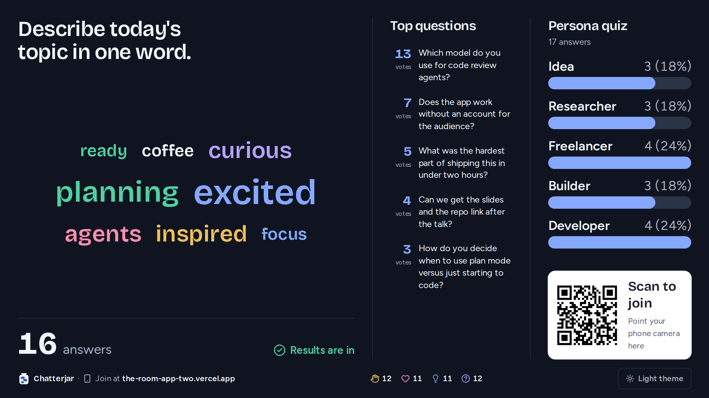
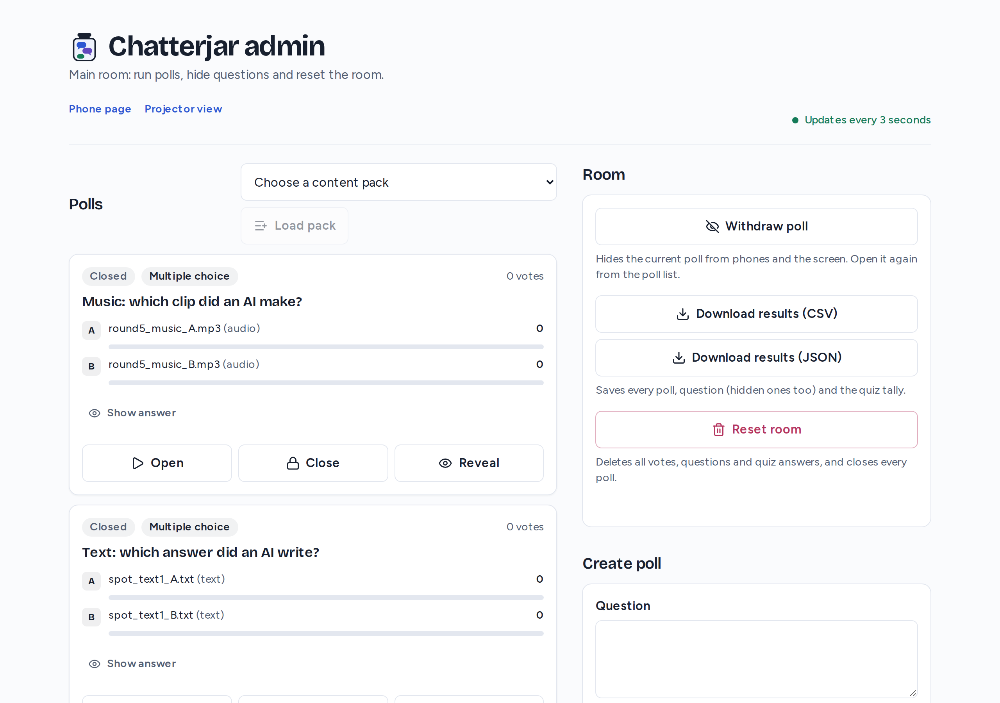

<p align="center">
  
</p>

<p align="center">
  <a href="https://the-room-app-two.vercel.app"><strong>Live demo</strong></a> &middot;
  <a href="#quickstart"><strong>Quickstart</strong></a> &middot;
  <a href="#run-a-session"><strong>Run a session</strong></a> &middot;
  <a href="#architecture"><strong>Architecture</strong></a> &middot;
  <a href="#development"><strong>Development</strong></a>
</p>

<p align="center">
  <a href="LICENSE"></a>
  
  
  
  <a href="https://github.com/Gayanukaa/chatterjar/actions/workflows/ci.yml"></a>
</p>

<br/>

# Chatterjar is the live audience app for talks, classes and conferences.

Open a link on the projector, show the QR code, and the whole room is in. People vote in polls, word clouds and ratings, ask and upvote questions, send live reactions and take a short quiz from their phones. You run everything from one admin page, and the results animate live on the big screen.

**No app to install. No sign-up. Nobody's name, email or phone number is collected.**

|        | Step              | What happens                                                                                              |
| ------ | ----------------- | --------------------------------------------------------------------------------------------------------- |
| **01** | Share the QR code | People scan it and land on the phone page. Each phone gets an anonymous device id.                        |
| **02** | Run the room      | Open a poll, watch questions and reactions arrive, see the quiz tally grow. Updates every 3 s by default. |
| **03** | Reveal together   | Press Reveal. The projector animates the results: bars, a word cloud or an average rating.                |

<br/>

<div align="center">
<table>
  <tr>
    <td align="center"><br/><sub><b>Vote</b>: one answer per device</sub></td>
    <td align="center"><br/><sub><b>Questions</b>: ask and upvote</sub></td>
    <td align="center"><br/><sub><b>Quiz</b>: find your persona</sub></td>
  </tr>
</table>
</div>

<p align="center">
  <br/>
  <sub><b>Projector view</b> (<code>/screen</code>): results after reveal, top questions, quiz tally, live reactions and a join QR code.</sub>
</p>

<p align="center">
  <br/>
  <sub><b>Dark theme</b> (<code>/screen?theme=dark</code>) with a word cloud poll.</sub>
</p>

<br/>

## Chatterjar is right for you if

- You give **talks, workshops, classes or conference sessions** and want the room to take part.
- You want **live polls** with a dramatic reveal, not a results chart everyone sees too early.
- You want an **anonymous question wall** where the best questions rise to the top, with a review queue when you need it.
- You want something people can join in **5 seconds from a QR code**, with nothing to install.
- You want to **own the app**: one Next.js repo and one Redis database, on your own Vercel account or your own server.

<br/>

## Features

<table>
<tr>
<td width="33%" valign="top">
<h3>Three poll types</h3>
Multiple choice (two to four options, with optional images, code, text or audio), word cloud (one short answer per phone) and rating (1 to 5). One answer per device. Results and the correct answer stay hidden until you press Reveal.
</td>
<td width="33%" valign="top">
<h3>Question wall</h3>
Questions of up to 200 characters, sorted by upvotes and then by time. One upvote per question per device, and not on your own question. 3 new questions per device per minute. Questions with strong language or a link wait for your approval, or turn on review for every question.
</td>
<td width="33%" valign="top">
<h3>Persona quiz</h3>
Short questions map each person to a persona. The room tally grows live on the projector. Each device counts once and keeps its result after a reload.
</td>
</tr>
<tr>
<td valign="top">
<h3>Projector view</h3>
A 1600 x 900 layout with large type: the active poll, the top five questions, the quiz tally, live reactions and a scan-to-join QR code. Bars, words and new questions animate in. Switch to a dark theme in the footer or open <code>/screen?theme=dark</code>.
</td>
<td valign="top">
<h3>Live reactions</h3>
Phones send applause, love it, great point or I'm lost. Reactions float up on the projector, with running totals. Each device can send 10 reactions per 10 seconds.
</td>
<td valign="top">
<h3>Admin console</h3>
Create polls of any type, load content packs, open, close and reveal, review and hide questions, withdraw the poll, reset the quiz or the whole room, download results and copy embed links. Answers stay hidden until you choose Show answer, so you can share your screen.
</td>
</tr>
<tr>
<td valign="top">
<h3>Embed in slides</h3>
Show the poll, the questions, the quiz tally, the join QR code or everything inside PowerPoint (Web Viewer add-in), reveal.js or any web page, in light, dark or transparent.
</td>
<td valign="top">
<h3>Rooms and export</h3>
Run many talks on one deployment with invite-only rooms. Download every poll, question (hidden ones too) and the quiz tally as CSV or JSON.
</td>
<td valign="top">
<h3>Built for a full room</h3>
Phones poll every 3 seconds by default with plain fetch, and hidden tabs pause. The shared room state is cached on the Vercel CDN for 1 s, and each phone fetches its own state only when it acts or the poll changes. All interface text lives in one typed catalog, ready for translation.
</td>
</tr>
</table>

<br/>

## Quickstart

### Deploy your own (5 minutes)

<a href="https://vercel.com/new/clone?repository-url=https%3A%2F%2Fgithub.com%2FGayanukaa%2Fchatterjar&project-name=chatterjar&repository-name=chatterjar&env=ADMIN_KEY&envDescription=A+long+random+string+that+unlocks+%2Fadmin+%28for+example%3A+openssl+rand+-hex+24%29&stores=%5B%7B%22type%22%3A%22integration%22%2C%22integrationSlug%22%3A%22upstash%22%2C%22productSlug%22%3A%22upstash-kv%22%2C%22protocol%22%3A%22storage%22%7D%5D"></a>

The button creates a Vercel project from this repo, adds a free Upstash Redis store and asks for an `ADMIN_KEY`. When it finishes, open `/admin#key=<ADMIN_KEY>` on your new site. (`?key=` also works, but `#key=` keeps the key out of server logs.)

### Run it locally

You need Node.js 24, a [Vercel](https://vercel.com) account and the Vercel CLI (`npm i -g vercel`).

```bash
git clone https://github.com/Gayanukaa/chatterjar.git
cd chatterjar
npm install

# Create the Vercel project and add Upstash Redis from the Vercel Marketplace
vercel link
vercel integration add upstash/upstash-kv

# Admin key: a long random string, for the deployed site and for local development
KEY=$(openssl rand -hex 24)
printf '%s' "$KEY" | vercel env add ADMIN_KEY production
printf '%s' "$KEY" | vercel env add ADMIN_KEY development
vercel env pull .env.local

npm run dev
```

Open http://localhost:3000 for the phone page, `/screen` for the projector and `/admin#key=<ADMIN_KEY>` for the admin console.

### Self-host with Docker

No Vercel or Upstash account needed. The stack runs the app, Redis and an Upstash-compatible REST proxy ([serverless-redis-http](https://github.com/hiett/serverless-redis-http)):

```bash
ADMIN_KEY=$(openssl rand -hex 24) SRH_TOKEN=$(openssl rand -hex 24) docker compose up --build
```

Open http://localhost:3000. Redis data persists in the `redis-data` volume. Add `SUPER_ADMIN_KEY` to enable rooms, `DATA_TTL_DAYS` to change retention, and `NEXT_PUBLIC_POLL_MS` (read at build time) to change the refresh rate. For a real event, put an HTTPS reverse proxy (Caddy, nginx, Cloudflare Tunnel) in front so phones can reach it.

**Deploy from GitHub:** connect the GitHub repo to the Vercel project. Every merge to `main` deploys production, and every pull request gets a preview. You can also run `vercel --prod`.

<details>
<summary><b>Environment variables</b></summary>

| Variable                               | Set by              | Purpose                                                                                                                              |
| -------------------------------------- | ------------------- | ------------------------------------------------------------------------------------------------------------------------------------ |
| `KV_REST_API_URL`, `KV_REST_API_TOKEN` | Upstash integration | Redis REST connection (falls back to `UPSTASH_REDIS_REST_URL` and `UPSTASH_REDIS_REST_TOKEN`)                                        |
| `ADMIN_KEY`                            | You                 | Unlocks the main room's admin page and API (sent in the `x-admin-key` header)                                                        |
| `SUPER_ADMIN_KEY`                      | Optional            | Owner key for `/admin/rooms`; also opens every room's admin page. Enables rooms                                                      |
| `DATA_TTL_DAYS`                        | Optional            | Days to keep votes, questions, upvotes, quiz answers and reactions after the last write (default 30, `0` keeps them). Polls are kept |
| `NEXT_PUBLIC_POLL_MS`                  | Optional            | How often pages refresh, in ms (default 3000, 2000 to 15000). Read at build time                                                     |
| `REDIS_PREFIX`                         | Optional            | Prefixes every Redis key, so tests and demos never touch live data                                                                   |
| `SRH_TOKEN`                            | Docker only         | Token between the app and the Redis REST proxy                                                                                       |
| `BASE_URL`, `E2E_ADMIN_KEY`            | Tests only          | Run the acceptance checks against a deployed site, or with your own admin key                                                        |

</details>

<br/>

## Run a session

1. Open `/admin#key=<ADMIN_KEY>` on your laptop. The page removes the key from the address bar.
2. Pick a content pack and click **Load pack**, or create a poll: multiple choice, word cloud or rating.
3. Put `/screen` on the projector (`/screen?theme=dark` for a dark room). It shows a scan-to-join QR code and the join address. To show the room inside your slides, copy a link from **Embed in slides**.
4. Click **Open** on a poll. Phones show the options and people vote.
5. Click **Reveal**. The projector animates the results and shows the correct answer, the word cloud or the average rating.
6. Turn on **Approve questions before they show** if you want to check every question. Questions with strong language or a link always wait in **Question review**. Use **Hide** on any question you do not want on the wall.
7. After the session, click **Download results (CSV)** or **(JSON)**.
8. After a rehearsal, click **Reset room**. It clears all votes, questions, quiz answers and reactions and withdraws the poll. Your polls stay. **Reset quiz tally** clears only the quiz.

<p align="center">
  <br/>
  <sub><b>Admin console</b> (<code>/admin</code>): answers stay hidden until you reveal or choose Show answer, so you can share this screen.</sub>
</p>

<br/>

## Rooms (invite-only)

One deployment can host many talks at once. Set `SUPER_ADMIN_KEY`, open `/admin/rooms` and create a room for each talk or speaker:

- Each room gets a 6-character code and its own pages: `/r/<code>` (phones), `/r/<code>/screen` (projector), `/r/<code>/admin` (speaker) and `/r/<code>/embed` (slides).
- Each room has its own admin link, `/r/<code>/admin#key=<token>`. The token is shown once, stored only as a hash, and unlocks only that room. Hand it to the speaker. The owner key also opens every room's admin page.
- Rooms never share data: polls, votes, questions and quiz answers live under separate Redis keys. **Delete room** removes the room and all of its data.
- `/`, `/screen` and `/admin` are the main room, unlocked by `ADMIN_KEY`. Without `SUPER_ADMIN_KEY`, the app runs as a single room.

Only the owner can create rooms, so a public deployment cannot fill up with strangers' rooms.

<br/>

## Embed in slides

`/embed` (or `/r/<code>/embed`) shows live room content without any page chrome and scales to any frame size. Options:

| Query   | Values                                              |
| ------- | --------------------------------------------------- |
| `show`  | `poll` (default), `questions`, `tally`, `qr`, `all` |
| `theme` | `light` (default), `dark`                           |
| `bg`    | `transparent` for overlays                          |

Use the link in the PowerPoint **Web Viewer** add-in, or paste the iframe code from the admin page into reveal.js or any web page (serve the deck over http or https). Google Slides cannot embed live pages, so show the join QR code there instead. Only embed pages may be framed by other sites.

<br/>

## Content packs

Polls you reuse live in JSON files in [`data/packs/`](data/packs). Three ship with the repo:

| Pack                | Polls | Content                                                                                                  |
| ------------------- | ----- | -------------------------------------------------------------------------------------------------------- |
| Demo: warm-up polls | 6     | General polls for any talk, a word cloud, a rating and one trivia question                               |
| Spot the AI         | 5     | Two photos, two texts and a music clip: which one did an AI make? Licences in [`SOURCES.md`](SOURCES.md) |
| Claude Code talk    | 1     | An exam-style question about planning a large change                                                     |

Each poll has a question and an optional `kind` (`choice`, `words` or `rating`; default `choice`). Choice polls need 2 to 4 options, with an optional `correct` option and media from `public/`. Word cloud and rating polls have no options. Optional `detail` and `source` fields show on the phone and after reveal. To add a pack, copy `data/packs/demo.json`, edit it, and list it in [`lib/packs.ts`](lib/packs.ts). The quiz lives in [`data/quiz.json`](data/quiz.json).

<br/>

## How far the free tiers go

Estimated for one 1-hour session with about 90 phones, the default 3 s refresh, one admin page open and the default 30-day retention:

| Service       | Free tier                                 | One session uses                                   | Sessions per month |
| ------------- | ----------------------------------------- | -------------------------------------------------- | ------------------ |
| Vercel Hobby  | about 1M edge requests, 1M function calls | about 110K edge requests, about 30K function calls | about 9            |
| Upstash Redis | 500K commands                             | about 30K to 55K commands                          | about 9 to 15      |

Every phone poll is one edge request, even when the CDN answers it, so the Vercel edge request quota is the limit. `NEXT_PUBLIC_POLL_MS=5000` cuts requests by about 40 percent. Vercel Hobby is for personal, non-commercial use; for more sessions, upgrade Vercel to Pro or self-host with Docker. Upstash pay-as-you-go costs about $0.20 per 100K commands.

<br/>

## Architecture

<p align="center">
  
</p>

- **Next.js 16 App Router** on Vercel: a phone page (`/`), a projector view (`/screen`), an admin console (`/admin`), an embed view (`/embed`), the owner's room list (`/admin/rooms`) and the same pages per room under `/r/<code>`.
- **API routes** under `app/api/` send `Cache-Control: no-store`, except `GET /api/room`. That route holds the shared state, is cached on the CDN for 1 s and never sets cookies. Admin routes need the admin key, the room token or the owner key in the `x-admin-key` header.
- **No WebSockets.** Clients fetch `/api/room` every 3 seconds by default, and fetch `/api/me` (this device's vote, upvotes and persona) only when something changes.
- **Upstash Redis** is the only database. Each room's keys are separate, and audience data expires after `DATA_TTL_DAYS`.
- An anonymous **`rid` cookie** (random UUID, 1 year) is set in `proxy.ts`, so each device votes once. Only `/embed` pages may be framed by other sites; every other page sends `X-Frame-Options: DENY`.

The diagram source is [`docs/architecture.drawio`](docs/architecture.drawio).

<br/>

## Development

| Command                           | What it does                                                            |
| --------------------------------- | ----------------------------------------------------------------------- |
| `npm run dev`                     | Start the dev server on port 3000                                       |
| `npm run build` / `npm start`     | Production build and server                                             |
| `npm run lint` / `npm run format` | ESLint and Prettier                                                     |
| `npm run test:unit`               | Vitest unit tests, plus a house-style test for comments and punctuation |
| `npm run test:e2e`                | 14 Playwright acceptance checks with two browser contexts (two devices) |

The acceptance checks start a dev server on port 3100 with `REDIS_PREFIX=e2e:` and their own admin and owner keys, so they need a Redis REST URL and token. They cover voting once per device, the reveal on phones and the projector, hiding a question, the question rate limit, the quiz tally, the layout at 360 px, withdraw and reset, separate rooms, export and the dark theme, the reaction limit, question review, word clouds, language fallback and embed framing. Set `BASE_URL` to run them against a deployed site; tests that change live data are then skipped.

**CI** runs on every pull request and on `main` in three jobs: lint, unit tests and build; the 14 acceptance checks against Redis behind a local REST proxy (no secrets needed); and a Docker self-host smoke test of the compose stack.

```
app/                     pages (/, /screen, /admin, /embed, /admin/rooms, /r/[code]/...) and API routes
components/              page shells, student, screen and admin UI
lib/                     domain rules, Redis client, state reader, rooms, i18n catalog, moderation, export
data/                    content packs (data/packs) and quiz questions
public/spot/             Spot-the-AI media
tests/                   unit and end-to-end tests
docs/                    architecture diagram and README assets
Dockerfile, docker-compose.yml   self-host stack
```

<br/>

## Contributing

Bug reports, ideas and pull requests are welcome. Read [`CONTRIBUTING.md`](CONTRIBUTING.md) for setup, house rules and how to add a language, and follow the [code of conduct](CODE_OF_CONDUCT.md). Report security problems privately as described in [`SECURITY.md`](SECURITY.md).

<br/>

## Content and licence

The code is MIT licensed (see [`LICENSE`](LICENSE)). The MIT licence does not cover the Spot-the-AI media in `public/spot/assets`. Each file keeps its own licence (CC0, CC BY, CC BY-SA or CC BY-NC); see [`SOURCES.md`](SOURCES.md) for credits and terms.
