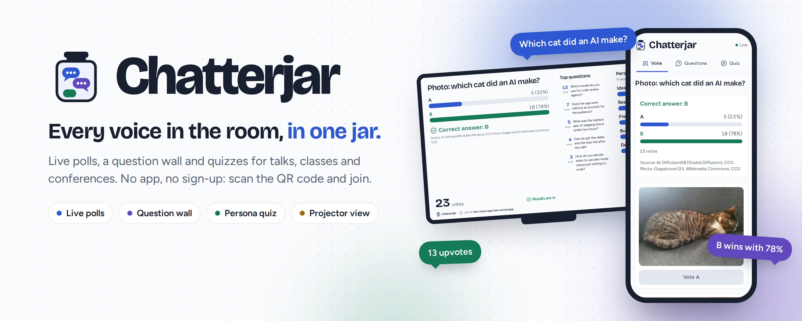
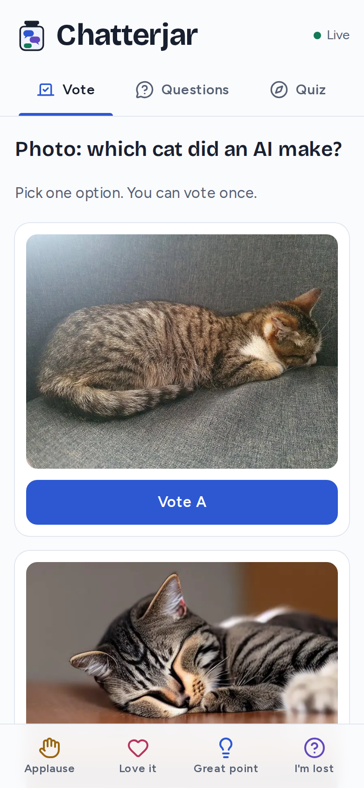
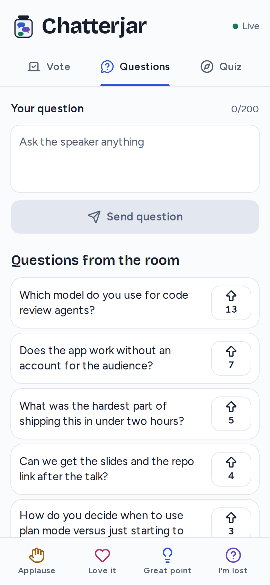
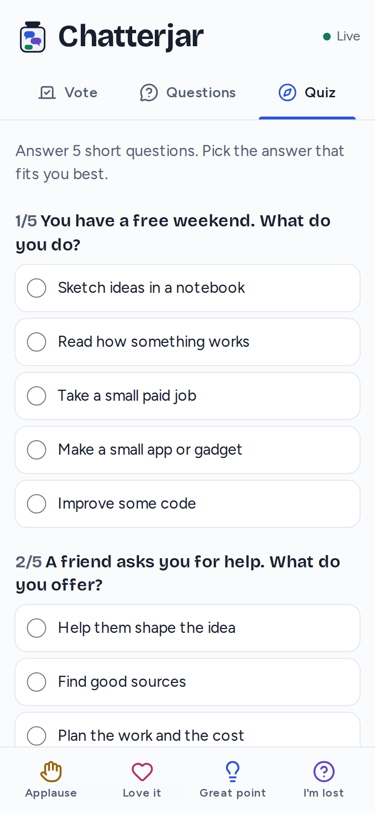
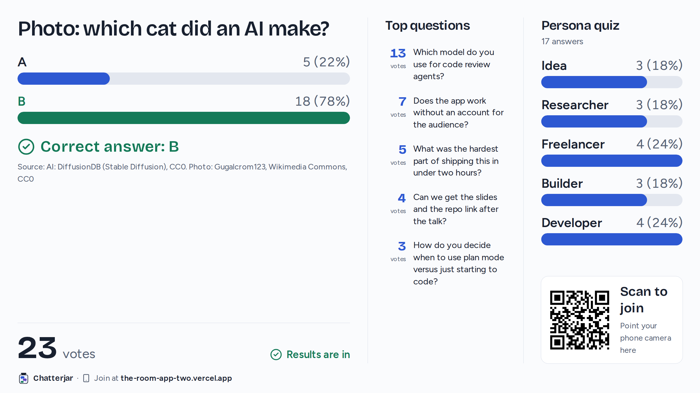
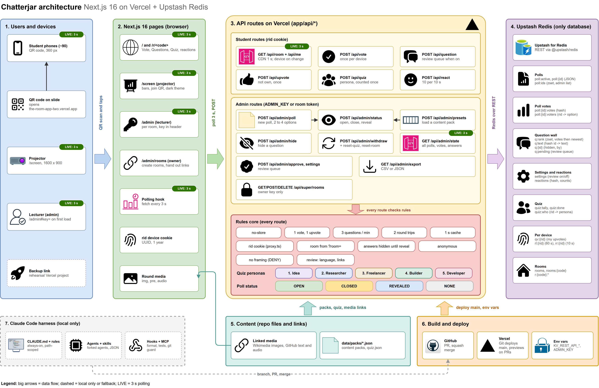

<p align="center">
  
</p>

<p align="center">
  <a href="LICENSE"></a>
  
  
  
  <a href="https://github.com/Gayanukaa/chatterjar/actions/workflows/ci.yml"></a>
</p>

# Chatterjar

Live polls, a question wall and a quiz for talks, classes and conferences. People join from a QR code on their phones. No app, no sign-up, no names.

## Features

- Choice and word cloud polls. Results stay hidden until you reveal them.
- An anonymous question wall with upvotes, a review queue and a limit of 3 questions per minute.
- A persona quiz with a live room tally, and live reactions.
- A projector view (`/screen`) with a join QR code and a dark theme.
- One admin page to run polls, load content packs and export CSV or JSON.
- Invite-only rooms, each with its own admin link.
- Audience data expires after 30 days by default.

<div align="center">
<table>
  <tr>
    <td align="center"><br/><sub><b>Vote</b></sub></td>
    <td align="center"><br/><sub><b>Ask</b></sub></td>
    <td align="center"><br/><sub><b>Quiz</b></sub></td>
  </tr>
</table>
</div>

<p align="center">
  
</p>

## Deploy

<a href="https://vercel.com/new/clone?repository-url=https%3A%2F%2Fgithub.com%2FGayanukaa%2Fchatterjar&project-name=chatterjar&repository-name=chatterjar&env=ADMIN_KEY&envDescription=A+long+random+string+that+unlocks+%2Fadmin+%28for+example%3A+openssl+rand+-hex+24%29&stores=%5B%7B%22type%22%3A%22integration%22%2C%22integrationSlug%22%3A%22upstash%22%2C%22productSlug%22%3A%22upstash-kv%22%2C%22protocol%22%3A%22storage%22%7D%5D"></a>

The button adds a free Upstash Redis store and asks for `ADMIN_KEY`. Then open `/admin#key=<ADMIN_KEY>`. The free tiers fit about 9 one-hour sessions of 90 people a month.

## Run locally

You need Node.js 24 and a Redis REST URL and token.

```bash
git clone https://github.com/Gayanukaa/chatterjar.git
cd chatterjar
npm ci
cp .env.example .env.local   # add Redis and ADMIN_KEY
npm run dev
```

Or self-host the app, Redis and a REST proxy with Docker:

```bash
ADMIN_KEY=$(openssl rand -hex 24) docker compose up --build
```

Open http://localhost:3000 on phones and `/screen` on the projector.

## Settings

- `ADMIN_KEY` (required): unlocks `/admin`.
- `SUPER_ADMIN_KEY` (optional): turns on rooms at `/admin/rooms`.
- `DATA_TTL_DAYS` (optional): days to keep audience data (default 30, `0` keeps it).

To add polls, drop a JSON file in `data/packs/`.

<p align="center">
  <br/>
  <sub>Next.js on Vercel, with Upstash Redis as the only database.</sub>
</p>

## More

Read [CONTRIBUTING.md](CONTRIBUTING.md), [SECURITY.md](SECURITY.md) and the [code of conduct](CODE_OF_CONDUCT.md).

## Licence

The code is MIT licensed (see [LICENSE](LICENSE)). The Spot the AI pack links media from its sources, which keep their own licences. [SOURCES.md](SOURCES.md) gives the credits and licences.
